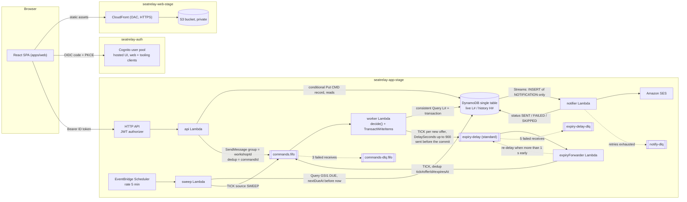
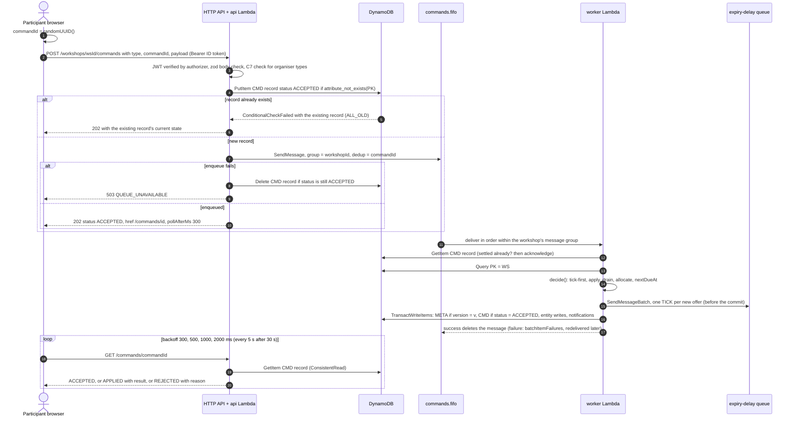
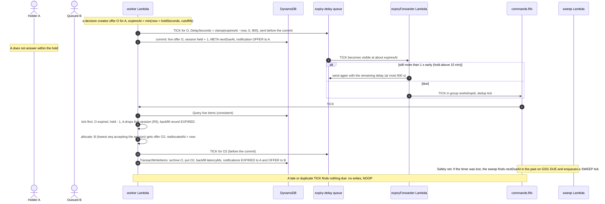

# SeatRelay architecture

This document describes the system as it is implemented in this repository. The functional
specification is `docs/plan/execution-plan.md` (§1.2 expiry, §1.3 polling, §2.x design); the
cross-package conventions are `docs/CONVENTIONS.md`. Where the implementation deviates from the
plan, the deviation is stated (section 17). Every claim names the file or function that implements
it, so a reader can check it against the code. The three Mermaid diagrams (sections 1.2, 3.2, 5.3)
are the sources for the Final report figures.

Contents: 1 Overview · 2 Layering · 3 Request path · 4 Worker path · 5 Expiry timers · 6 Sweep ·
7 Notifier · 8 Data model · 9 Rules R1–R7 · 10 Constraints C1–C7 · 11 Consistency and idempotency ·
12 Failure modes · 13 Cost-relevant choices · 14 Security · 15 On-prem mapping · 16 Deployment
summary · 17 Deviations from the plan

---

## 1. System overview

SeatRelay runs registration for one workshop that is offered in 2–5 equivalent sessions. A
participant registers **once** with an ordered list of acceptable sessions and joins **one** queue
per workshop. When a seat is free, the engine offers it to the first queued person (by arrival
order) who accepts that session. The offer is held for a time limit (`holdSeconds`, default 900 s,
minimum 30 s). A seat that is released (expiry, decline, cancellation, capacity increase) is relayed
to the next person automatically. Organisers see capacity, queue, offers, confirmations, a backfill
log with latencies, distinct participants served, attendance and a CSV export, and can check the
invariants with one click (`verify`).

Two deployments run the same application layer and engine:

- **Cloud (AWS, `ap-southeast-1`)**: CloudFront + S3 (SPA), Cognito (OIDC), API Gateway HTTP API
  with a JWT authorizer, Lambda (`api`, `worker`, `expiryForwarder`, `sweep`, `notifier`), SQS FIFO
  plus a standard delay queue, a single DynamoDB table with Streams, SES, EventBridge Scheduler,
  CloudWatch. Templates: `services/aws/templates/{auth,app,web}.yaml`.
- **On-premise reference** (Docker Compose): nginx (SPA), Keycloak, one Node process (Fastify API
  plus in-process worker, timer, sweep, notifier and janitor loops), PostgreSQL 16, Mailpit.
  `services/local/docker-compose.yml`. It exists for the cost comparison and to show functional
  parity (section 15).

### 1.1 Components (cloud)

| Component | Resource | Code | Role |
|---|---|---|---|
| SPA | S3 (private) + CloudFront (OAC) | `apps/web` | React app. Signs in with authorization code + PKCE. Sends the Cognito **ID token** as the bearer token. Generates `commandId`s and polls command results. |
| Identity | Cognito user pool, `web` + `tooling` clients, hosted UI | `templates/auth.yaml` | Users, e-mail verification, tokens. `tooling` (password auth) is used only by scripts and k6. |
| API | HTTP API (JWT authorizer) → `api` Lambda (512 MB, 10 s) | `services/aws/src/handlers/api.ts` → `packages/service/src/api/app.ts` | Synchronous reads and CRUD. Writes a command record, enqueues the command and answers 202. Serves the polling endpoint. |
| Command queue | `seatrelay-{stage}-commands.fifo` (+ FIFO DLQ, `maxReceiveCount` 3) | `services/aws/src/adapters/sqs.ts` | One ordered path per workshop: `MessageGroupId = workshopId`. Deduplication ids are explicit. |
| Worker | `worker` Lambda (1024 MB, 20 s, `BatchSize` 1, `MaximumConcurrency` 5) | `handlers/worker.ts` → `packages/service/src/worker/processCommand.ts` → `packages/core/src/decide.ts` | The only writer of a workshop's live state. Runs load → decide → timers → transactional commit. |
| Timers | `seatrelay-{stage}-expiry-delay` (standard, + DLQ) → `expiryForwarder` Lambda | `adapters/sqs.ts` (`SqsTimerScheduler`), `handlers/expiryForwarder.ts` | One delayed TICK per offer. The forwarder moves it into the FIFO. |
| Safety net | EventBridge Scheduler `rate(5 minutes)` → `sweep` Lambda | `handlers/sweep.ts` → `packages/service/src/worker/sweep.ts` | Sends a TICK to every workshop whose `nextDueAt` has passed (sparse DUE index). |
| Store | DynamoDB `seatrelay-{stage}` (on-demand, PITR, TTL `ttl`, Streams `NEW_AND_OLD_IMAGES`) | `services/aws/src/adapters/dynamo/*` | Single table: live (`L#`) and history (`H#`) prefixes inside the workshop partition. |
| Notifier | Streams (filter `INSERT` + `entityType = NOTIFICATION`) → `notifier` Lambda → SES | `handlers/notifier.ts`, `adapters/ses.ts` | E-mail for in-app notifications, paced at ≤ 1 e-mail/s. Records SENT / FAILED / SKIPPED. |
| Observability | CloudWatch Logs (14 d), EMF metrics (`SeatRelay` namespace), alarms → SNS, dashboard, X-Ray | `services/aws/src/lib/{logger,metrics}.ts`, `templates/app.yaml` | `CommandSettledLatency`, `BackfillLatency`, `OffersCreated/Expired`, `SweepLateExpiries`, `MetaConflictRetries`, `NotificationFailures`. |

### 1.2 Figure A — architecture (cloud)



---

## 2. Layering: where the logic lives

```
packages/contracts  zod schemas + types (API bodies, commands, entities, enums, error codes)
packages/core       pure engine: decide() (tick-first), allocate(), checkInvariants(), PER_SESSION strategy
packages/service    ports + route table (createApiApp) + worker orchestration (processCommand, runSweep)
services/aws        DynamoDB / SQS / SES adapters + 5 thin Lambda handlers + SAM templates
services/local      Postgres adapter + Fastify server + in-process loops (same ports)
apps/web            SPA (depends on contracts only)
```

- **Every business rule is in `packages/core`.** `decide(snapshot, command, { now, newId })` is pure.
  It never reads a clock or generates ids itself, and it returns
  `Decision { status, reason?, writes: Change[], notifications, timers, backfills, continuation?, metrics, resultForCommand? }`
  (`packages/core/src/decide.ts`).
- **The API behaviours and the worker protocol are in `packages/service`.** This covers idempotent
  intake, 503 rollback, C7 checks, load/decide/schedule/commit/retry and fault injection.
- **Adapters map 1:1 and run no business logic.** Each `Change` kind (`PUT_WORKSHOP_STATE`,
  `PUT_SESSION`, `PUT_REGISTRATION`, `ARCHIVE_REGISTRATION`, `PUT_OFFER`, `ARCHIVE_OFFER`,
  `PUT_BACKFILL`, `PUT_PENDING_BACKFILL`, `ARCHIVE_BACKFILL`) becomes fixed DynamoDB items
  (`DynamoWorkshopStore.buildTransaction`) or fixed SQL rows (`services/local/src/adapters/postgres/store.ts`).
- Handlers are thin. `handlers/api.ts` converts `APIGatewayProxyEventV2` to `ApiRequest`, calls
  `createApiApp().handle`, and converts the result back. `handlers/worker.ts` calls `processCommand`
  per SQS record.

---

## 3. Request path: SPA → 202 → polling

### 3.1 Steps

1. **Sign-in.** The SPA uses `react-oidc-context` (code + PKCE) against Cognito (local: Keycloak).
   It keeps the user in `localStorage` and sends the **ID token** as `Authorization: Bearer`. The ID
   token carries `email` and `name`; the `aud` claim is the client id
   (`apps/web/src/auth/SeatRelayAuthProvider.tsx`, `authAdapter.ts`).
2. **Authorizer.** The HTTP API JWT authorizer checks signature, issuer and audience (`web` and
   `tooling` client ids) before any Lambda runs. Routes are declared per method (`GET|POST|PUT|PATCH|DELETE /{proxy+}`),
   so CORS pre-flight `OPTIONS` requests are answered by API Gateway and not rejected by the
   authorizer. `GET /health` and `GET /public/workshops/{wsId}` have no authorizer (`templates/app.yaml`).
3. **Identity.** `userFromEvent` (`services/aws/src/lib/auth.ts`) reads `sub`, `email` and `name` from
   the verified claims and builds `AuthUser`. Request bodies never carry the actor:
   `buildCommand(body, wsId, actor)` (`packages/contracts/src/commands.ts`) injects `workshopId`,
   `actorUserId`, `actorEmail` and `actorDisplayName`.
4. **Synchronous routes.** Reads, organisation and workshop CRUD, attendance, export and verify answer
   directly (route table `API_ROUTES`, `packages/service/src/api/app.ts`, plan §2.5). Workshop
   creation, title edits and attendance are synchronous REST writes. Everything that changes a
   workshop's live state is a **command**.
5. **Command intake** (`postCommand`, `packages/service/src/api/routes/commands.ts`):
   - The browser generates `commandId = crypto.randomUUID()` and keeps it until the command settles,
     so a retry reuses it (`apps/web/src/commands/useCommand.ts`).
   - The body is validated with `CommandBodySchema` (zod). Invalid input returns 400 `VALIDATION_ERROR`.
     `_fault` is deleted unless `allowFaultFlags` is set.
   - Organiser command types require org membership: 403 `FORBIDDEN` otherwise (C7).
   - `putCommandAccepted` writes `CMD#{commandId}` with `status = ACCEPTED` and `acceptedAt`. It is a
     `PutItem` with `attribute_not_exists(PK)` and `ReturnValuesOnConditionCheckFailure: ALL_OLD`.
   - If the record already exists, the API returns that record's current state with 202, with no
     second read. If it is still `ACCEPTED` the API enqueues it again (the FIFO dedup id drops the
     copy). A `commandId` reused by another user or workshop returns 409 `CONFLICT`.
   - The API enqueues on `commands.fifo` with group `workshopId` and dedup id `commandId`. If the
     enqueue fails, `deleteCommandIfAccepted` (conditional delete) runs and the API returns 503
     `QUEUE_UNAVAILABLE`, so the browser never polls an orphan.
   - Response: **202** `{ commandId, type, workshopId, status: 'ACCEPTED', acceptedAt, href: '/commands/{id}', pollAfterMs: 300 }`.
6. **Polling** (`GET /commands/{id}`): a **consistent** `GetItem` of the record. It returns 404 unless
   the caller issued the command or organises its workshop. The browser polls after
   300 → 500 → 1000 → 2000 ms (capped). After 30 s it polls every 5 s and shows a "still processing"
   hint (`apps/web/src/commands/backoff.ts`, `pollCommand.ts`). The terminal states are
   `APPLIED { result }` and `REJECTED { reason }`. `result.registration` is the same summary as the
   public view's `me` (status, queue position, current offer and its `expiresAt`), so the UI updates
   from the poll alone and never reads an eventually consistent index right after settlement.
7. **Changes caused by other users** (for example, an offer created by a backfill) reach the browser
   through the status pages. They refetch every 10 s while a registration is QUEUED/OFFERED, and
   pause while the tab is hidden (`apps/web/src/api/queries.ts`, `LIVE_REFRESH_MS`). There are no
   WebSockets: at pilot scale they add an API type, a connection table and a failure point for no
   measurable gain (plan §1.3).

Latency definitions used everywhere (plan §1.3):

- **server settle latency** = `settledAt − acceptedAt`. Both timestamps are on the CMD record, and
  the latency is emitted as `CommandSettledLatency`.
- **client-observed settle latency** = time from the POST to the poll that saw the terminal state.
  It includes up to one polling interval. k6 polls every 200 ms.
- **backfill latency** = `reallocatedAt − releasedAt` on the `BackfillRecord`, emitted as
  `BackfillLatency`. For an expiry, `releasedAt` is the offer's `expiresAt`.

### 3.2 Figure B — command sequence (202 → poll → settled)



---

## 4. Worker path

`createWorkerHandler` (`services/aws/src/handlers/worker.ts`) consumes `commands.fifo` with
`BatchSize: 1`, `ReportBatchItemFailures` and `MaximumConcurrency: 5`. SQS FIFO delivers messages of
one group (= one workshop) in order and holds back the next message of that group while one is in
flight. Each workshop therefore has a single, serial writer. Different workshops are processed in
parallel, up to the concurrency limit. `processCommand(ports, command, { faultInjection, deliveryAttempt })`
(`packages/service/src/worker/processCommand.ts`) then runs these steps:

1. **Fast idempotency check (user commands).** It reads `CMD#{commandId}`. If the record is already
   APPLIED/REJECTED, the message is a redelivery. The worker runs one internal TICK pass
   (`convergeAfterSettled`), which finishes a continuation that a crash after the commit may have
   lost and is a no-op otherwise. It then acknowledges the message with outcome `ALREADY_SETTLED` (C3).
2. **Snapshot.** `loadSnapshot(wsId)` runs a consistent `Query PK = WS#{wsId} AND begins_with(SK, 'L#')`.
   It reads only live items: META, sessions, live registrations, live offers and pending backfill
   records (`DynamoWorkshopStore.loadSnapshot`). History never enters the snapshot, so its size is
   bounded by capacity and queue length, not by the workshop's age.
3. **Settled-offer lookup.** For an `ACCEPT_OFFER`/`DECLINE_OFFER` whose offer is no longer live, the
   worker reads the archived offer (`getArchivedOffer` → `H#O#{offerId}`) and attaches it as
   `snapshot.settledOffers`. A timer that archived the offer first then leads to `OFFER_EXPIRED`, not
   `OFFER_NOT_FOUND` (`attachSettledOffer`).
4. **Organiser re-check (C7).** `decideAuthorised` checks org membership again for organiser
   commands. A message that bypassed the API settles as `REJECTED(FORBIDDEN)`.
5. **`decide()` with the server time** `clock.now()` (`packages/core/src/decide.ts`):
   1. **tick-first** (`tick.ts`): expire every live offer with `expiresAt ≤ now` (seat released,
      `BackfillRecord(EXPIRED, releasedAt = expiresAt)`, R5 applied to the holder). Then end every
      QUEUED registration whose acceptable sessions have all passed their cut-off (ENDED, CUTOFF).
   2. **apply** the command or reject it with a deterministic `RejectReason` (`apply.ts`).
   3. **drain** organiser cancellations (`drain.ts`, CANCELLING → CANCELLED in budget-sized steps).
   4. **allocate** (`allocate.ts`): scan QUEUED registrations by `seq`. Offer each one the first
      session in its preference order that is OPEN, before cut-off and has
      `capacity − confirmed − held > 0`. `expiresAt = min(now + holdSeconds, cutoffAt)`. A seat taken
      here fills the oldest pending backfill record of its session.
   5. **recompute `nextDueAt`** (`computeNextDueAt`) and bump `version`.

   Limits per decision: at most 12 offers, 12 expiries and 90 storage items (`DEFAULT_DECISION_LIMITS`,
   `packages/core/src/state.ts`). Remaining work is carried by a `REALLOCATE` continuation, and
   `nextDueAt = now` is kept meanwhile so that the sweep finishes the chain if the continuation is lost.
6. **Internal command with nothing to do** (a late or duplicate TICK) → `NOOP`, no commit.
7. **Timers before the commit.** `timers.schedule(wsId, decision.timers)` sends one TICK per new offer
   to the delay queue (`SqsTimerScheduler`, `SendMessageBatch` of 10). The timer is sent first: if
   the commit then fails, the TICK finds nothing to expire and is harmless. This order removes the
   "committed but timer never sent" case entirely.
8. **Commit** (`DynamoWorkshopStore.commit`) is **one `TransactWriteItems`** (≤ 100 items, asserted;
   `TransactionTooLargeError` otherwise):
   - META `Update` of the engine-owned fields `status, seq, version, nextDueAt, updatedAt` with
     `ConditionExpression: version = :expectedVersion`. This is the optimistic lock of the whole
     workshop partition. The `L#DUE` marker is put or deleted alongside.
   - `CMD#{commandId}` `Update` with `attribute_not_exists(PK) OR status = ACCEPTED`. It writes the
     settled record (`status`, `reason?`, `result?`, `settledAt`).
   - Entity changes. Upserts for sessions, live registrations (plus the R1 marker) and pending
     backfills. `attribute_not_exists(PK)` for new offers, history items and notifications.
     `ARCHIVE_*` is a Delete of the live item plus a Put of the history item.
   - Conditions only on items that are written, never a `ConditionCheck` on an untouched item
     (100-item limit, and a Put plus a ConditionCheck on the same key is a ValidationException).
9. **Conflicts** (`TransactionCanceledException`, mapped by `CancellationReasons[i].Code`):
   - The CMD item failed: the command is `COMMAND_ALREADY_SETTLED`. The worker acknowledges it and
     runs the convergence pass. This is checked first.
   - META failed: `VERSION`. The worker reloads the snapshot and decides again, up to 3 times. It
     counts `MetaConflictRetries` and throws `VersionConflictError` after that.
   - Anything else is thrown and the message is redelivered.
10. **After the commit**: enqueue `decision.continuation` (if any), then emit `CommandSettledLatency`,
    `OffersCreated`, `OffersExpired`, `BackfillLatency` and, for sweep ticks, `SweepLateExpiries`.

**Failure policy** (`createWorkerHandler`):

- A deterministic rejection is a *successful* settlement (`REJECTED`) and never throws.
- A malformed message is logged and dropped. It can never succeed, and failing it would block its
  workshop's group.
- Infrastructure errors (DynamoDB/SQS failures, exhausted version retries, injected faults) report
  the failed record **and every following record** in `batchItemFailures`, as the FIFO partial-batch
  rule requires.
- The queue's `VisibilityTimeout` (120 s) is at least 6 × the worker timeout (20 s). A message is
  therefore never redelivered while its first processing is still running.

Fault injection (dev only): with `ALLOW_FAULT_FLAGS=true`, `_fault: TIMER_SEND | BEFORE_COMMIT | AFTER_COMMIT`
throws `FaultInjectedError` at that point on the **first delivery only** (`ApproximateReceiveCount = 1`).
The redelivery then shows the recovery path.

---

## 5. Expiry timers

### 5.1 Semantics: tick-first (plan §1.2)

Expiry is decided by **server time at processing**, not by which message arrives. Every decision
starts by expiring every offer with `expiresAt ≤ now`. A TICK is therefore only a wake-up call ("run
a decision for this workshop now"). It carries `offerId`/`expiresAt` only for deduplication and logs;
the engine never expires *by id*. Consequences:

- A late, duplicate or stale TICK is a no-op: nothing is due → no writes → `NOOP`.
- An `ACCEPT` processed after `expiresAt` is rejected `OFFER_EXPIRED`, whether the timer arrived
  first, arrives later, or never arrives (`lookupOwnLiveOffer` also checks `expiresAt` directly).
- An `ACCEPT` processed before `expiresAt` wins, even if its timer message is already queued
  behind it.
- A late TICK can never invalidate a newer offer, because that offer's `expiresAt` lies in the future.

Any command processed after `expiresAt` performs the expiry. In the dev smoke run of 2026-10-17
(`results/2026-10-17-smoke-dev/run.log`), the late `ACCEPT` itself expired the offer (tick-first) and
the seat was relayed to the next person 88 ms after `expiresAt`. That is one sample, not a statistic.
The latency distribution is the backfill experiment's job (`docs/EXPERIMENTS.md`).

### 5.2 Mechanism

- **Per-offer timer.** For each new offer the worker sends `TICK{workshopId, source: 'TIMER', offerId, expiresAt}`
  to the **standard** queue `expiry-delay` with `DelaySeconds = clamp(ceil((expiresAt − now)/1000), 0, 900)`
  (`delaySecondsFor`, `SqsTimerScheduler`). The timer goes on a standard queue because SQS FIFO
  queues do not support per-message timers. 900 s is the SQS message-timer maximum.
- **Forwarder** (`handlers/expiryForwarder.ts`). It is invoked when the delayed message becomes
  visible:
  - If the TICK is still more than 1 s early (`RE_DELAY_THRESHOLD_MS`; this happens for holds longer
    than 15 min), it is sent back to the delay queue with the remaining delay, clamped to 900 s again.
    Holds up to the 24 h maximum therefore work in hops of at most 15 min.
  - Otherwise it is enqueued on `commands.fifo` in the **workshop's message group**, so the expiry
    goes through the same ordered single-writer path as user commands.
  - Failures are reported per record (standard queue, partial batch). After 5 receives a message
    goes to `expiry-delay-dlq`.
- **Deduplication ids on the FIFO** (`dedupIdFor`, `adapters/sqs.ts`):

  | Message | Dedup id |
  |---|---|
  | User command | `commandId` |
  | Timer tick | `tick#{offerId}#{expiresAt}` |
  | Sweep tick | `sweep#{wsId}#{minute}` |
  | REALLOCATE | fresh UUID (no natural key; a duplicate is a no-op anyway) |

  SQS drops a duplicate within its 5-minute deduplication window. Outside the window, tick-first and
  the CMD condition make duplicates harmless anyway.
- **Latency budget** of an expiry-driven relay: delay-queue visibility (SQS timer, seconds
  granularity) + forwarder invocation + FIFO enqueue + worker decision and transaction. A relay
  caused by a cancellation or decline happens **in the same transaction** as the release
  (`latencyMs = 0`) and is reported separately. The 120 s target (Table 3) is an acceptance ceiling;
  the measured values come from `results/<date>-backfill/`.

### 5.3 Figure C — offer → timer → tick → backfill



---

## 6. Sweep safety net

- **Key.** `nextDueAt = min(earliest live offer expiresAt, earliest future cutoffAt of an OPEN session with QUEUED/OFFERED demand, now while a continuation is pending)`.
  It is undefined when nothing is pending (`computeNextDueAt`, `packages/core/src/decide.ts`).
- **Sparse index.** When `nextDueAt` is set, the commit puts an `L#DUE` item with `GSI1PK = 'DUE'`,
  `GSI1SK = {nextDueAt}#{wsId}`. Otherwise it deletes the item, in the same transaction as the META
  update. Only workshops with pending work are in the index, whatever their status: CLOSED
  workshops still expire offers, and a CANCELLING workshop keeps `nextDueAt = now` until its drain
  completes.
- **Schedule.** EventBridge Scheduler `rate(5 minutes)` invokes `sweep`. `runSweep`
  (`packages/service/src/worker/sweep.ts`) calls `listDueWorkshops(now)`, which queries
  `GSI1PK = 'DUE' AND GSI1SK ≤ now#…`. Each candidate is confirmed with a consistent read of its
  META, because the GSI is eventually consistent. One `TICK{source: 'SWEEP'}` is enqueued per due
  workshop.
- **What it covers.** Lost or failed timers (timer DLQ, forwarder outage). The R4 cut-off: past the
  cut-off nothing is offered, and a registration whose sessions have all passed it ends with `CUTOFF`.
  Lost `REALLOCATE` continuations. Recovery from a failure within 5 minutes.
- **Signal.** The worker emits `SweepLateExpiries` = offers that a SWEEP tick expired more than 60 s
  after their `expiresAt` (`SWEEP_LATE_GRACE_MS`). In normal operation it is **0**: the timers did
  the work and every sweep tick is a no-op. **The sweep interval does not bound backfill latency**;
  only the timer path is on the latency path.

---

## 7. Notifier

- **Generation.** The engine emits `NotificationDraft`s (OFFER, CONFIRMED, EXPIRED, DECLINED,
  REVOKED, SESSION_CANCELLED, WORKSHOP_CANCELLED, ENDED; `packages/core/src/notifications.ts`). The
  worker turns them into `Notification` items (`U#{userId}`/`N#{createdAt}#{id}`,
  `entityType = NOTIFICATION`, `status = PENDING`, TTL 90 d) and writes them **in the same
  transaction** as the state change (`materializeNotification`). They are visible at once in the
  in-app notification centre (`GET /me/notifications`), independent of e-mail.
- **Trigger.** A DynamoDB Streams event source with `FilterCriteria`
  `{"eventName":["INSERT"],"dynamodb":{"NewImage":{"entityType":{"S":["NOTIFICATION"]}}}}`. Only
  inserts invoke the function: the notifier's own status updates (MODIFY) and TTL deletions (REMOVE)
  never re-trigger it. Settings: `BatchSize 10`, `MaximumBatchingWindowInSeconds 1`,
  `BisectBatchOnFunctionError`, `MaximumRetryAttempts 20`, `MaximumRecordAgeInSeconds 3600`,
  `ReportBatchItemFailures`, on-failure destination `notify-dlq`.
- **Delivery** (`handlers/notifier.ts`):
  - `EMAIL_ENABLED != true` (dev): the notification is marked `SKIPPED` (in-app only).
  - Otherwise the notifier skips items that are no longer `PENDING` (a retried batch never sends
    twice), waits for a token-bucket slot (`EMAIL_RATE_PER_SEC`, default 1/s), sends with SES
    `SendEmail` (text + minimal HTML) and marks the item `SENT`.
- **Failure policy** (`adapters/ses.ts` classifies errors):
  - A **permanent** SES error (`MessageRejected`, e.g. an unverified recipient while the account is
    in the SES sandbox) marks the item `FAILED` with `lastError` and is **not** retried.
  - A **transient** error (throttling, 5xx) stops the batch at that record and reports it in
    `batchItemFailures`. The stream retries from there; after 20 attempts or 1 h the record goes to
    `notify-dlq`.
  - Both kinds count `NotificationFailures`. Alarms: notify DLQ not empty, notifier `IteratorAge > 60 s`.
- **SES sandbox status** (`docs/deployment-state.md`): production access was denied on 2026-10-17
  while the sender identity was unverified. Until it is granted, dev runs with `EmailEnabled=false`.
  Participants rely on in-app notifications, and e-mail only reaches verified team addresses (plan §9).

---

## 8. Data model

### 8.1 Key table (plan §2.3, translated)

Single table `seatrelay-{stage}`: string PK/SK, on-demand, PITR on, Streams `NEW_AND_OLD_IMAGES`,
TTL attribute `ttl` (epoch seconds).

| Item | PK | SK | Notes |
|---|---|---|---|
| Organization | `ORG#{orgId}` | `META` | members; GSI1 `U#{userId}` → `ORG#` for "my organisations" |
| Workshop | `WS#{wsId}` | `L#META` | seq / version / holdSeconds / nextDueAt; GSI1PK `ORG#{orgId}`, GSI1SK `WS#{createdAt}`; sparse `GSI1PK = 'DUE'` only while something is due |
| Session | `WS#{wsId}` | `L#S#{sessionId}` | capacity / confirmed / held / cutoffAt |
| Live registration | `WS#{wsId}` | `L#R#{seq:08d}` | QUEUED / OFFERED / CONFIRMED; GSI1PK `U#{userId}`, GSI1SK `WS#{wsId}` for "my registrations" |
| Uniqueness marker | `WS#{wsId}` | `L#U#{userId}` | `{seq, status}`; R1 / C2; O(1) consistent read |
| Live offer | `WS#{wsId}` | `L#O#{offerId}` | OFFERED only |
| History registration / offer | `WS#{wsId}` | `H#R#{seq}` / `H#O#{offerId}` | on settlement: Delete live + Put history in the same transaction |
| BackfillRecord | `WS#{wsId}` | `H#BF#{releasedAt}#{id}` | dashboard and backfill latency |
| Attendance | `WS#{wsId}` | `H#A#{userId}` | synchronous API write |
| CommandResult | `CMD#{commandId}` | `META` | TTL 30 days; acceptedAt / settledAt / result |
| Notification | `U#{userId}` | `N#{createdAt}#{id}` | `entityType = NOTIFICATION`; TTL 90 days |

### 8.2 As implemented (`services/aws/src/adapters/dynamo/keys.ts`, `mapping.ts`)

- **Live/history split.** Inside the `WS#` partition, everything the engine needs to decide is under
  `L#`. Everything settled is under `H#`. The worker's snapshot query (`begins_with(SK,'L#')`) never
  reads history, so its cost stays flat while experiments accumulate thousands of settled items.
  Archiving is a Delete of the live item plus a Put of the history item in the same transaction.
- **DUE key on its own item.** The DUE key lives on `L#DUE` (`GSI1PK = 'DUE'`, `GSI1SK = {nextDueAt}#{wsId}`),
  because the workshop META item already uses GSI1 for the per-organisation listing. It costs one
  extra item per commit, inside the engine's 10-item reserve (90 + extras ≤ 100).
- **Membership items.** Organisation membership is also stored as one item per member
  (`ORG#{orgId}`/`M#{userId}`, GSI1 `U#{userId}`).
- **Pending backfill records** (a released seat not yet relayed while a continuation is pending) are
  live items `L#BF#{releasedAt}#{id}`. They are returned as `snapshot.pendingBackfills` and archived
  to `H#BF#…` once relayed or closed.
- **R1 marker scope.** `L#U#{userId}` in UNIFIED mode, `L#U#{userId}#{sessionId}` in PER_SESSION mode
  (`registrationScopeKey`). It is upserted with the registration and deleted on archive.
- History registrations keep GSI1 `U#{userId}`, so "my registrations" lists past ones too.
- Every item carries `entityType`. Reads are validated with the contracts zod schemas.
- **TTL.** CommandResult `ttl = acceptedAt + 30 d`. Notification `ttl = createdAt + 90 d`.
  Workshop history has no TTL (organisers need it for the export).
- **Postgres equivalent** (`services/local/sql/schema.sql`): tables `organizations`, `org_members`,
  `users`, `workshops` (partial index `workshops_due_idx` on `next_due_at` = the DUE index),
  `sessions`, `registrations` (unique `registrations_r1_idx (workshop_id, scope_key)`) +
  `registrations_history`, `offers` + `offers_history`, `backfill_records` (`pending` flag),
  `command_results`, `notifications`, `attendance`, `commands` (the queue) and `timers`.

### 8.3 Entities and enums

Defined once in `packages/contracts/src/{entities,enums}.ts`:

| Entity | Statuses |
|---|---|
| Workshop | `OPEN \| CLOSED \| CANCELLING \| CANCELLED`, mode `UNIFIED \| PER_SESSION` |
| Session | `OPEN \| CANCELLING \| CANCELLED`, `cutoffAt = startsAt − 30 min` |
| Registration | `QUEUED \| OFFERED \| CONFIRMED \| CANCELLED \| ENDED`, end reasons `CUTOFF \| NO_ACCEPTABLE_SESSION \| WORKSHOP_CANCELLED` |
| Offer | `OFFERED \| ACCEPTED \| DECLINED \| EXPIRED \| REVOKED` |
| CommandResult | `ACCEPTED \| APPLIED \| REJECTED` |
| Notification | `PENDING \| SENT \| FAILED \| SKIPPED` |
| BackfillRecord cause | `EXPIRED \| DECLINED \| CANCELLED_CONFIRMED \| CANCELLED_OFFER \| CAPACITY_UP \| SESSION_CANCELLED` |

---

## 9. Rules R1–R7: where each is enforced

| Rule | Statement (plan §2.2) | Enforced in |
|---|---|---|
| **R1** | One live registration per account per workshop (per session in PER_SESSION mode). | `register()` in `packages/core/src/apply.ts` via `registrationConflicts()` (`perSession.ts`) → `ALREADY_REGISTERED`. Atomic because of the single writer and the META version lock. Mirrored by the `L#U#…` marker (`uniqueMarkerItem`, `DynamoWorkshopStore.buildTransaction`) and, on-prem, by the unique index `registrations_r1_idx`. Checked by `checkInvariants` code `R1_DUPLICATE_REGISTRATION`. |
| **R2** | Queue order = FIFO arrival order = `seq` assigned by the worker. | `register()`: `seq = workshop.seq + 1`. A single writer per workshop: FIFO group = `workshopId` (`commandGroupId`, `packages/service/src/commands.ts`). The META `version` condition rejects any concurrent writer. |
| **R3** | Allocation scans the queue in `seq` order and gives each person the first acceptable session (preference order) with a free seat. | `allocate()` / `firstAllocatableSession()` (`allocate.ts`), `isAllocatable()` (`snapshot.ts`). |
| **R4** | Holds expire at `expiresAt = min(now + holdSeconds, cutoffAt)`; `cutoffAt = startsAt − 30 min`; nothing is offered after cut-off. | `offerExpiry()` (`allocate.ts`), `cutoffFor()` (`factories.ts`), workshop creation rejects sessions already past cut-off (`packages/service/src/api/routes/orgs.ts`), `tickFirst()` → `expireDueOffers()` / `endCutoffRegistrations()` (`tick.ts`), timers (section 5) and sweep (section 6). Invariant `OFFER_AFTER_CUTOFF`. |
| **R5** | Decline or expiry removes that session from the person's list. If nothing is left the registration ends; otherwise it returns to QUEUED with its `seq` and is allocated again at once. | `declineOffer()` (`apply.ts`), `expireOffer()` (`tick.ts`) → `dropSessionFromRegistration()` (`state.ts`) → `ENDED(NO_ACCEPTABLE_SESSION \| CUTOFF)` or QUEUED. `allocate()` runs in the same decision. |
| **R6** | Cancellation exits completely, from any live status. Re-registering gets a new `seq`. | `cancelRegistration()` / `cancelOne()` (`apply.ts`): archive as CANCELLED, release the held or confirmed seat (`CANCELLED_OFFER` / `CANCELLED_CONFIRMED` backfill), relay it in the same decision. |
| **R7** | Capacity change: reject `capacity < confirmed + held`; an increase allocates at once. CANCEL_SESSION revokes offers and re-queues confirmed people without that session. | `setCapacity()` (`apply.ts`) → `INVALID_CAPACITY` / `CAPACITY_BELOW_USAGE`. `pendingCapacityUp` → `allocate()` (`CAPACITY_UP` backfill only when someone takes the seat). `cancelSession()` + `drainCancellations()` (`drain.ts`). |

Deterministic reject reasons (`REJECT_REASONS`, contracts) each have a unit test in
`packages/core/test/*.test.ts`. A fast-check property test (2,000 random sequences, up to 200 steps,
random clock advances) asserts `checkInvariants` after every step (`packages/core/test/property.test.ts`).

---

## 10. Constraints C1–C7: where each is enforced

| Constraint | Meaning (as used in plan and code) | Enforced in |
|---|---|---|
| **C1** | No over-capacity: `confirmed + held ≤ capacity`; `held` = live OFFERED offers of the session; `confirmed` = CONFIRMED registrations. | Offers only when `freeSeats > 0` (`isAllocatable`). Counters change only inside the engine (`createOffer`, `acceptOffer`, `settleOffer`, `cancelOne`, the cancellation drains). R7 check in `setCapacity`. All of it is committed atomically under the META lock. Checked by `checkInvariants`: `C1_OVER_CAPACITY`, `C1_HELD_MISMATCH`, `C1_CONFIRMED_MISMATCH`, exposed by `GET …/verify`. |
| **C2** | At most one OFFERED/CONFIRMED hold per account per workshop (UNIFIED). | R1 (one live registration) plus one `currentOfferId` per registration. `allocate()` only offers to QUEUED registrations. Checked by `checkInvariants`: `C2_DUPLICATE_HOLD` (`holdScopeKey`). |
| **C3** | Idempotent commands: repeating a command never applies it twice. | Client `commandId`. `putCommandAccepted` (conditional, `ALL_OLD`). FIFO dedup id = `commandId`. The worker's settled-check, and the CMD condition `attribute_not_exists OR status = ACCEPTED` **inside the same transaction as the effects** (`commandResultUpdate`). `COMMAND_ALREADY_SETTLED` → acknowledge. See section 11. |
| **C4** | Defined in the Preliminary report. That document is not in this repository; copy its wording into the Final report together with the mapping. | Properties the code enforces that are not covered by C1–C3, C5 or C7, to map C4/C6 onto: per-workshop ordering (R2, FIFO group); cut-off (R4); durable notifications (written in the decision's transaction, section 7); auditability (CMD records with `acceptedAt`/`settledAt`, backfill records with `latencyMs`, history items). |
| **C5** | Expiry correctness, with tick semantics (the plan's rewording): expiry is decided by server time at processing, and a late tick can never invalidate a newer, unexpired offer. | `tickFirst()` (`tick.ts`) runs before every command. `lookupOwnLiveOffer()` checks `expiresAt` directly. `attachSettledOffer` (`processCommand.ts`) answers `OFFER_EXPIRED` when the tick won the race. Ticks never expire by id. Section 5.1. |
| **C6** | Defined in the Preliminary report (see C4). | See the C4 row. |
| **C7** | Organiser access only for members of the workshop's organisation. | API: `requireOrgMember`, `assertOrganiser`, `requireOrgWorkshop` (`packages/service/src/api/context.ts`) → 403/404. Organiser command types are checked in `postCommand`. The worker re-checks in `decideAuthorised` (`REJECTED(FORBIDDEN)`). `GET /commands/{id}` returns 404 unless the caller is the issuer or an organiser. Participant-level ownership: `OFFER_NOT_YOURS` (engine). |

---

## 11. Consistency and idempotency argument

**Single writer per workshop.** Live state under `WS#{wsId}/L#…` changes only through decisions.
Decisions run only in the worker, and the worker receives a workshop's messages from one FIFO
message group. SQS + Lambda process one message of a group at a time and in order.
Synchronous API writes never touch engine-owned fields:

- `updateWorkshopInfo` writes only title, description and `updatedAt` on META, not `version`.
- Attendance and CMD records are other items.

**Optimistic lock as a second line of defence.** Every commit is conditional on
`version = snapshot.version` and sets `version + 1`. Suppose two decisions on the same workshop ever
overlap: a delivery after a visibility timeout (prevented by 120 s ≥ 6 × 20 s), or a manually injected
message. Only one commit succeeds; the other reloads and decides again on the new state. The commit
is one `TransactWriteItems`, so a decision is all-or-nothing: seats, registrations, offers, backfill
records, notifications, the CMD settlement and the DUE marker change together or not at all. C1, C2
and R1 therefore hold after every commit, because each decision preserves them on a consistent
snapshot (property-tested in `packages/core/test/property.test.ts`).

**Exactly-once effect per `commandId` (C3).**

1. **At most once.** A command's effects and its CMD settlement are in the same transaction, and
   the CMD update is conditional on `status = ACCEPTED` (or no record). After one commit succeeds,
   the record is APPLIED or REJECTED. Every later attempt, whether a redelivery, a duplicate POST
   outside the SQS 5-minute dedup window, or a concurrent duplicate, fails that condition. The whole
   transaction is cancelled with it, so no effect is applied twice. The worker reports
   `ALREADY_SETTLED` and acknowledges.
2. **At least once.** The API answers 202 only after both the record write and the enqueue succeed.
   If the enqueue fails, the record is rolled back and the client sees 503, then retries with the
   same `commandId`. A record orphaned by an API crash is re-enqueued on the client's retry. SQS
   redelivers until the commit succeeds or the message reaches the DLQ after 3 receives, which raises
   an alarm.
3. **The visible result is stable.** `GET /commands/{id}` reads the record consistently, and a
   re-POST returns the same record. A redelivered message can never overwrite APPLIED with, say,
   `REJECTED(ALREADY_REGISTERED)`, because the condition forbids it.

**Tick semantics (C5).** A TICK has no authority of its own; it only causes "expire what is due at
the server's now". Expiry is a function of `(expiresAt, now)`, evaluated inside the serialised
decision. So:

- Duplicate and late ticks are no-ops.
- Missing ticks are covered by the next decision of any kind, or by the sweep.
- An ACCEPT and an expiry can never both win. The decision that runs first at or after `expiresAt`
  expires the offer, and every later decision sees it archived (`settledOffers` → `OFFER_EXPIRED`).

The server clock is the Lambda clock (`systemClock`), ISO-8601 UTC with milliseconds. Browser
countdowns are advisory.

**Read consistency.** The polling endpoint and the worker snapshot use strongly consistent reads.
The command result carries the participant's registration summary, so the UI never needs an
eventually consistent GSI read right after settlement. `verify` reads the live snapshot outside the
worker. While a REALLOCATE continuation is still queued it may briefly report `NO_STARVATION`, so
experiments call it after the queue has drained.

**Ordering cost.** Writes to *one* workshop are serialised by design: this is the price of the
ordering and single-lock guarantees. Throughput across workshops scales with worker concurrency. The
hot-spot load test measures the single-workshop limit (`docs/EXPERIMENTS.md`, Performance).

---

## 12. Failure modes and what happens

| Failure | What happens | Evidence / signal |
|---|---|---|
| Worker crashes **before the commit** (timeout, DynamoDB error, `_fault: BEFORE_COMMIT`) | Nothing is written. Timers already sent produce no-op ticks. The message reappears after the 120 s visibility timeout and is processed normally. The workshop's group waits meanwhile; other workshops are unaffected. | Worker `Errors`, log `deliveryAttempt: 2`; `failure-recovery` experiment |
| Worker crashes while **sending timers** (`TIMER_SEND`) | Same as above. The redelivery sends the timers again; duplicates are harmless. | `failure-recovery` |
| Worker crashes **after the commit** (`AFTER_COMMIT`, timeout after commit) | The redelivery finds the CMD settled and acknowledges `ALREADY_SETTLED`. It also runs a convergence TICK, which finishes a lost continuation. Effects stay exactly once. | Log "command already settled; acknowledging redelivery"; `repeat-execution`, `failure-recovery` |
| TICK or REALLOCATE crashes after the commit | Redelivered. It is naturally idempotent: nothing due → `NOOP`. | — |
| META version conflict | Reload and decide again, up to 3 times; then throw → redelivery. Not expected with one consumer per group. | `MetaConflictRetries` (expected 0; `concurrency` experiment) |
| Poison or malformed message | Malformed: logged and dropped. Repeated infrastructure failure: after 3 receives → `commands-dlq.fifo`, which unblocks the group. | Alarm `commands-dlq-not-empty`; redrive per `docs/RUNBOOK.md` §5 |
| Backlog or stuck group | Messages age in the queue. | Alarm `commands-oldest-message-age > 120 s` |
| Enqueue fails at the API | The CMD record is deleted and the API returns 503 `QUEUE_UNAVAILABLE`. The client retries with the same `commandId`. | `api` logs "enqueue failed" |
| API crashes between the record and the enqueue | The record stays ACCEPTED. The client's retry (same `commandId`) re-enqueues it; FIFO dedup drops a double. | — |
| Timer lost or late (delay DLQ, forwarder down) | Any later command performs the expiry (tick-first). Otherwise the sweep ticks the workshop within 5 min. | `SweepLateExpiries > 0`, alarm `expiry-dlq-not-empty` |
| Duplicate timers | Dropped by the FIFO dedup id within 5 min, and no-ops anyway. | — |
| Continuation lost after the commit | `nextDueAt = now` keeps the workshop in the DUE index, so the sweep resumes the chain. A redelivered user command's convergence pass also resumes it. | — |
| DynamoDB throttling or transient errors | SDK retries; then throw → redelivery (worker) or 500 (API). | `api-errors` / `worker-errors` alarms |
| SES sandbox (unverified recipient) | `MessageRejected` → notification `FAILED`, not retried. In-app notification still present. | `NotificationFailures`; status in `GET /me/notifications` |
| SES throttling or outage, notifier down | The stream retries from the failed record (bisect, 20 attempts, 1 h max age), then sends it to `notify-dlq`. State changes are unaffected: notifications are decoupled. | `IteratorAge` alarm, `notify-dlq` alarm; `failure-recovery` notifier-outage case |
| Cognito e-mail quota | Cognito's own mailer sends 50 verification e-mails/day/account. | Pre-created accounts (`create-test-users` with `MessageAction SUPPRESS`) for experiments and the demo |
| AZ failure | The managed services are multi-AZ. | — |
| Region failure | Not covered: single region. Recovery from DynamoDB PITR (RPO ≈ minutes) by redeploying the stacks. | — |

---

## 13. Cost-relevant design choices

Prices and the per-dimension model are in `docs/COST.md` (`tools/experiments/cost/pricing.json`,
`model.py`, output `results/cost/model-summary.md`). The design choices that drive cost:

1. **Pay-per-request everywhere**: HTTP API, Lambda, SQS, DynamoDB on-demand, SES per message.
   Idle cost is near zero apart from fixed items (alarms, dashboard, PITR storage). HTTP API was
   chosen over REST API: lower request price and a built-in JWT authorizer.
2. **arm64 Lambda, right-sized memory** (api 512 MB, worker 1024 MB). The worker uses `BatchSize 1`
   for latency. The documented optimisation is BatchSize 10 with a shared snapshot per group, if the
   hot-spot p95 exceeds 5 s (plan §2.4).
3. **Live/history split.** The snapshot query reads only live items, so read units per command are
   bounded by capacity + queue, not by history.
4. **One transaction per decision.** `TransactWriteItems` costs twice a plain write per item. This is
   the price of atomicity. The 90-item budget keeps each command bounded.
5. **Timers instead of polling.** Each offer costs one SQS send, one forwarder invocation and one FIFO
   message. The sweep runs only every 5 min (about 8,640 invocations/month) and queries a **sparse**
   index of workshops with pending work.
6. **Client polling with backoff** (300 → 2000 ms, 5 s after 30 s). Status pages refresh every 10 s
   only while something is pending and the tab is visible. Consistent reads cost twice eventual
   reads, so their number is bounded.
7. **Stream filter on the notifier.** Only notification inserts invoke it; every other table write is
   free for the notifier.
8. **Low-cardinality metrics.** EMF metrics carry only the `service` dimension, because each distinct
   metric/dimension combination is billed. There are no per-workshop or per-user dimensions.
9. **Retention by TTL and log retention.** Explicit log groups keep 14 days. DynamoDB TTL deletes
   command records (30 d) and notifications (90 d) without write cost.
10. **Spend guards.**
    - Budgets of US$20/month and US$60/year with `IncludeCredit: false`; otherwise credits keep the
      measured spend at 0.
    - `Project=SeatRelay` cost-allocation tags.
    - API throttling (dev 300 rps / 500 burst, pilot 50 / 100) and worker `MaximumConcurrency 5`.
    - `tools/scripts/bin/teardown.sh` empties the bucket and deletes app + web stacks.
11. **CloudFront `PriceClass_200`.** It is needed because `PriceClass_100` has no Singapore edge.
12. **The on-premise reference** prices one machine, power, backup, mail and labour against the same
    workload. The crossover analysis is in `results/cost/model-summary.md`.

---

## 14. Security

| Concern | Implementation |
|---|---|
| Authentication | Cognito user pool: e-mail as username (case-insensitive), verified e-mail, `PreventUserExistenceErrors`, password policy ≥ 8 characters. The SPA is a public client using code + PKCE and holds **no secrets** (`env.js` contains only public ids). The API Gateway JWT authorizer validates signature, issuer, audience and expiry before the Lambda runs. Only `/health` and `/public/workshops/{wsId}` are anonymous. On-prem: `jose` RS256 verification against the Keycloak JWKS (`iss`, `aud`, `exp`; `services/local/src/auth.ts`). |
| Actor integrity | `actorUserId` and `actorEmail` come from verified claims only (`buildCommand`). The body never carries them. |
| Authorisation (C7) | Org membership on every organiser route and organiser command, checked in the API and again in the worker. Cross-organisation paths return 404 after the 403 membership check. Command results are invisible (404) to anyone other than the issuer or the workshop's organisers. Offer ownership is checked by the engine (`OFFER_NOT_YOURS`). |
| Input validation | zod schemas from `@seatrelay/contracts` for every body and path parameter (`parseBody`, `validateParams`) → 400 `VALIDATION_ERROR`. Malformed JSON returns 400. Queue messages are re-validated in the worker (`CommandSchema`). DynamoDB reads are validated on mapping. Lengths are capped (title 200, description 5,000, name 120). |
| Fault flags | `_fault` is stripped by the API unless `ALLOW_FAULT_FLAGS=true` (dev only); pilot runs with `false`. |
| IAM, least privilege per function (SAM policy templates scoped to this stack's resources) | `api`: CRUD on the table + Send on `commands.fifo`. `worker`: CRUD on the table + Send on `commands.fifo` and `expiry-delay`. `expiryForwarder`: Send on those two queues, no table access. `sweep`: **read-only** on the table + Send on `commands.fifo`. `notifier`: CRUD on the table + Send on `notify-dlq` + `ses:SendEmail`/`SendRawEmail`. The table-level CRUD template is broader than the minimal action set; the possible tightening is in section 17. |
| PII minimisation | Only e-mail and display name (from the ID token) are stored. Passwords live only in Cognito/Keycloak. Lambda events are never logged verbatim (`POWERTOOLS_LOGGER_LOG_EVENT=false`). Errors go to clients as `{ code, message }` without stack traces. |
| Retention | CommandResult 30 days and Notification 90 days (DynamoDB TTL; on-prem `janitor.ts`). Logs 14 days. |
| Transport and storage | HTTPS only: CloudFront `redirect-to-https`, API Gateway HTTPS. CloudFront managed security-headers policy. Private S3 with Origin Access Control (SigV4), four public-access blocks, `BucketOwnerEnforced`, SSE-S3. DynamoDB encrypted at rest (service default). |
| Abuse limits | API throttling per stage, CORS limited to the CloudFront origin and `http://localhost:5173` (headers `authorization`, `content-type`), SES pacing, worker concurrency cap. |
| Supply chain | `pnpm install --frozen-lockfile` and `pnpm audit --audit-level high` in CI (`.github/workflows/ci.yml`). Lambda bundles keep `@aws-sdk/*` external (runtime-provided). |
| Test identities | The Cognito `tooling` client (password auth) and the Keycloak `tooling` client exist only for scripts and k6, with generated test accounts. Real participants use the `web` client. |

---

## 15. On-premise mapping

| AWS component | On-prem component (`services/local`) | Notes |
|---|---|---|
| CloudFront + S3 | nginx `web` container (`nginx/default.conf`, `entrypoint.sh`) | The same Vite build. `/env.js` is generated at start. |
| Cognito (hosted UI, `web` / `tooling` clients) | Keycloak 26, realm `seatrelay` (`keycloak/realm-export.json`), clients `seatrelay-web` / `tooling` | Same issuer string for browser and server (`KC_HOSTNAME`); the server fetches JWKS on the container network. |
| HTTP API + JWT authorizer + `api` Lambda | Fastify 5 (`src/server.ts`) + `jose` verification (`src/auth.ts`) around `createApiApp().handle` | One catch-all route per method, plus `/public/workshops/{wsId}` and `/metrics`. |
| `commands.fifo` (group = workshopId, dedup id) | `commands` table: head-of-line claim per workshop, `dedup_id UNIQUE` (`src/adapters/postgres/queue.ts`) | Strict FIFO per workshop even with several workers. |
| FIFO DLQ (3 receives) | `status = 'FAILED'` after `WORKER_MAX_ATTEMPTS` (3) | Retry backoff `WORKER_RETRY_BACKOFF_MS × attempt`. |
| `worker` Lambda | Worker loop (`src/worker.ts`): `FOR UPDATE SKIP LOCKED` + `pg_advisory_xact_lock(hashtext(workshop_id))` → `processCommand` | One SQL transaction per command. |
| `TransactWriteItems` + META version condition | One SQL transaction; `UPDATE workshops … WHERE version = expected` | The version check is kept although the advisory lock already serialises writers. |
| `expiry-delay` queue + `expiryForwarder` | `timers` table + timer loop (`src/timers.ts`, every `TIMER_POLL_MS` = 1 s) | Timer rows are inserted **inside** the decision's transaction (no "before commit" step needed). |
| EventBridge `rate(5 minutes)` + `sweep` | Sweep loop (`createSweepLoop`, `SWEEP_INTERVAL_MS` = 300,000) | Same `runSweep`. |
| Sparse DUE GSI | Partial index `workshops_due_idx` on `next_due_at` | — |
| R1 marker item | Unique index `registrations_r1_idx (workshop_id, scope_key)` | Second line of defence. |
| DynamoDB Streams + `notifier` + SES | Notifier loop (`src/notifier.ts`) polling PENDING rows → nodemailer SMTP → Mailpit | SENT / FAILED / SKIPPED; `EMAIL_ENABLED`. |
| DynamoDB TTL | Janitor loop (`src/janitor.ts`) | Deletes expired command results and notifications, old timers and DONE queue rows. |
| CloudWatch EMF metrics, dashboard | In-process aggregates (`src/metrics.ts`), `GET /metrics`, periodic log line | Same metric names. |
| CloudWatch Logs | Docker JSON logs (`docker compose logs server`) | — |
| DynamoDB PITR, multi-AZ | Single host. Backups are costed in `docs/COST.md` but not automated in the compose file. | An availability difference, stated in the cost comparison. |

---

## 16. Deployment summary

| Stack | Template | Lifetime | Stage differences |
|---|---|---|---|
| `seatrelay-auth` | `templates/auth.yaml` | Deployed once, never deleted (users live here); budgets, SES identity | — |
| `seatrelay-app-dev` / `-pilot` | `templates/app.yaml` | Per stage; dev can be torn down | dev: `AllowFaultFlags=true`, `EmailEnabled=false`, throttle 300/500, no table deletion protection. pilot: `false`, `true`, 50/100, deletion protection on. |
| `seatrelay-web-dev` / `-pilot` | `templates/web.yaml` | Per stage | — |

Build: `services/aws/scripts/build.mjs` (esbuild, ESM, `node22`, arm64 runtime `nodejs22.x`,
`@aws-sdk/*` external) produces `dist/<fn>/index.mjs`. `sam deploy --config-env <env>` uses
`services/aws/samconfig.toml`. Procedures: `docs/RUNBOOK.md`. Live identifiers:
`docs/deployment-state.md`.

---

## 17. Deviations from the plan (and why)

| Plan | Implementation | Reason |
|---|---|---|
| Lambda `nodejs20.x` | `nodejs22.x`, esbuild target `node22` | nodejs20.x reached end of support on 2026-04-30 (`docs/CONVENTIONS.md` §2). |
| DUE key on the workshop META item | Separate `L#DUE` item in the same transaction | META already uses GSI1 for the per-organisation listing. |
| R1 "conditional write on the marker item" | The engine check under the single writer and META lock enforces R1. The marker is upserted as a mirror (plus a unique index on-prem). | The workshop-level optimistic lock already makes the decision atomic. A marker condition would need the same key semantics across archive and re-register in one transaction. |
| Workshop statuses `OPEN \| CLOSED \| CANCELLED` | Adds `CANCELLING` (workshop and session) | Organiser cancellations are drained in budget-sized commits (≤ 100 items per transaction). |
| Offers per command ≤ 12 | Also ≤ 12 expiries and ≤ 90 storage items per decision | Keeps every commit within the DynamoDB transaction limit. |
| IAM "notifier: DDB Update" | SAM `DynamoDBCrudPolicy` on the table | Simplicity. Tightening to `GetItem`/`UpdateItem` (notifier) and scoping `ses:SendEmail` to the identity ARN are possible follow-ups. |
| Mechanism comparison "also one real replay per mode on dev" | Simulation only (`tools/replay`) | No deployed replay script exists. See `docs/EXPERIMENTS.md`. |
