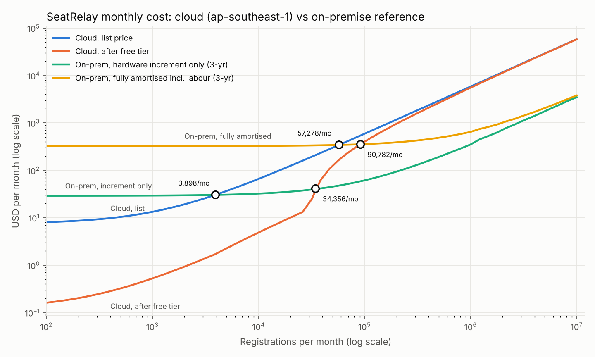
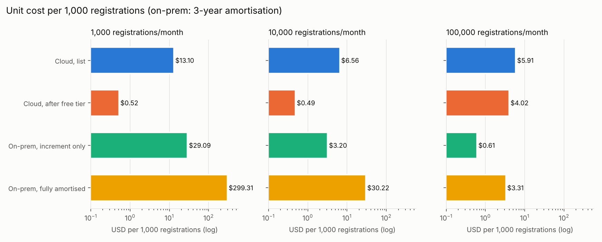

# Cost model: cloud vs on-premise (method for Final section 2)

This document explains how the SeatRelay cost comparison in the Final report is produced and
where every number comes from. The inputs, the model and the outputs live in the repository:

| Artefact | Path | Role |
|---|---|---|
| Unit prices | `tools/experiments/cost/pricing.json` | ap-southeast-1 (Singapore) prices for every billable dimension the stack uses, with source URL, retrieval date (2026-10-16), free-tier allowances and a verification flag per entry |
| On-prem inputs | `tools/experiments/cost/onprem.json` | hardware, power, tariff, network, backup, e-mail, labour and FX assumptions, each with source and verification flag |
| Model | `tools/experiments/cost/model.py` | workload model, three cloud layers, two on-prem views, crossover, charts; `--usage`/`--from-snapshot` price measured usage |
| Output | `results/cost/model-summary.md`, `results/cost/crossover.png`, `results/cost/unit-cost.png`, `results/cost/crossover-curve.csv` | regenerated with `python3 tools/experiments/cost/model.py` |
| Measured usage | `results/cost/usage-<date>-cloudwatch.{json,md}` and `usage-<date>-cloudwatch-priced.md` (from `tools/experiments/cost/cloudwatch_usage.py`), `results/cost/snapshots/<date>.json` (from `tools/scripts/bin/cost-snapshot.sh`), `results/cost/usage-priced.md` (the last priced usage; now the CloudWatch day) | plan section 3 step 24 |

Notation: `pricing.json: <key>` refers to `prices.<key>.usd` in that file; `onprem.json: <path>` refers to the
JSON path. "Verified" below means the price was read from the AWS Price List API file named in the entry's
`source_detail` on 2026-10-16 (`verification: verified_pricelist`); entries with any other flag are called out.

## 1. Scope: what is billed

The deployed stack (`services/aws/templates/app.yaml`, `auth.yaml`, `web.yaml`) touches 31 billable
dimensions across HTTP API, Lambda (arm64), SQS (standard + FIFO), DynamoDB on-demand (+ Streams, PITR,
storage), SES, CloudFront + S3, Cognito, CloudWatch (metrics, alarms, dashboard, logs, API), X-Ray,
EventBridge Scheduler, SNS and regional data transfer. All 31 unit prices except one were verified from the
Price List API; the exception is `pricing.json: cw_dashboard_month` (US$3.00/dashboard-month, 3 free),
which does not appear in the Price List API and is marked `unverified` (it is immaterial: one dashboard per
stage, inside the free 3). Free-tier allowances were confirmed either in the price list itself (DynamoDB
storage and Streams, EventBridge Scheduler, SNS), from official page excerpts (CloudFront, X-Ray, Cognito,
regional data transfer), or only from secondary sources (Lambda, SQS, CloudWatch, S3); the API Gateway
12-month allowance could not be confirmed and is flagged `unverified`.

Two pricing changes in 2025-2026 matter for how the model is read:

- Accounts created on or after 2025-07-15 do not get the legacy 12-month allowances; they get Free Tier
  credits (up to US$200 over 6 months) plus the always-free allowances (`pricing.json: meta.free_tier_regime`).
  The model therefore applies only always-free allowances by default (`--legacy-free-tier` adds the 12-month ones).
- SES introduced pricing plans on 2026-07-21; accounts that start sending after that date are on the
  Essentials plan at US$0.16 per 1,000 (`pricing.json: ses_email_essentials`) rather than the a-la-carte
  US$0.10 (`pricing.json: ses_email_alacarte`), and the SES free tier is closed to new customers. The model
  uses Essentials by default (`--ses-alacarte` is the sensitivity).

## 2. Three-layer cloud accounting

For a month with usage quantities `q_d` on dimension `d` with unit price `p_d` (from `pricing.json`, applying
the volume tiers where they exist) and free allowance `f_d`:

1. **List price**: `L1 = sum_d price_d(q_d)`. This is what any customer without allowances or credits
   would pay, and is the number used for the unit-cost comparison and the crossover.
2. **After free tier**: `L2 = sum_d price_d(max(0, q_d - f_d))`, with `f_d` = `free_always` (and
   `free_12mo` only with `--legacy-free-tier`). The SQS pool (1M requests) is shared by standard and FIFO
   queues and is applied standard-first.
3. **After credits**: `L3 = max(0, L2 - credits_remaining) = 0` for as long as the account's promotional or
   educational credits last. The model reports 0 and labels it as such; the amount the credits absorb each
   month is `L2`.

**Why Cost Explorer shows 0 net.** Cost Explorer's `NetUnblendedCost` (and the console's default "net"
views) subtracts credits at the line-item level, so an account running on credits shows a net cost of 0
for every service even though usage is being metered and priced normally; `UnblendedCost` still shows the
pre-credit charge. This is also why the budgets in `auth.yaml` set `CostTypes.IncludeCredit: false` (plan
section 2.4): with credits included, actual spend would read 0 and the alarm could never fire.
`tools/scripts/bin/cost-snapshot.sh` therefore records three metrics (`UnblendedCost`, `NetUnblendedCost`,
`UsageQuantity`) by service and by usage type, and the billing layer is computed from `UsageQuantity`:
`python3 tools/experiments/cost/model.py --from-snapshot results/cost/snapshots/<date>.json` sums the
usage quantities over the period, maps Cost Explorer usage types to `pricing.json` keys (`USAGETYPE_MAP` in
`model.py`) and prices them in layers 1 and 2 (`results/cost/usage-priced.md`). A hand-written
`{pricing_key: quantity, "registrations": N}` file can be priced the same way with `--usage`.

**Measured usage of the experiment day (CloudWatch).** Cost Explorer lags about a day and covers only
tagged usage since the cost allocation tag became active, so the experiment day was read from the
service metrics instead: `python3 tools/experiments/cost/cloudwatch_usage.py --date 2026-10-17 --price`
(read-only AWS calls) finds the resources of the SeatRelay stacks, sums their billing-relevant AWS/*
metrics over the window and writes the `{pricing_key: quantity}` object
`results/cost/usage-2026-10-17-cloudwatch.json` and, per resource, the metrics, conversions and
assumptions in `usage-2026-10-17-cloudwatch.md`. `--price` then runs `model.py --usage` on the object
(into a temporary `--out`, so `model-summary.md` and the charts are not overwritten) and copies the
priced table to `usage-2026-10-17-cloudwatch-priced.md` and to `results/cost/usage-priced.md`, the file
`report/tools/report_numbers.py` reads. For 2026-10-17 00:00-20:20 UTC, dev and pilot stages, it gives
US$3.25 at list price (US$1.86 without the month's Cognito MAU line of US$1.40) and US$1.19 after the
free tier. The main assumptions, all in that `.md`:

- SQS bills API calls, which no metric counts directly, so requests = sends + empty receives + one
  receive and one delete call per consumer Lambda batch (central estimate; low/high bounds per queue
  in the file).
- `data_transfer_out_gb` is API Gateway `DataProcessed`, which counts request and response bytes: an
  upper bound on data transfer out.
- Cognito MAU is every user in the pool, an upper bound on the month's MAU and a month-level charge
  put into one day; CloudFront requests are all priced at the Asia Pacific HTTPS rate (upper bound).
- The after-free-tier figure applies the whole month's free allowances to this window alone.
- No metric counts REGISTER commands, so the object has no `registrations` entry and gives no measured
  unit cost; the per-registration drivers of section 3 stay modelled.

## 3. Workload model (registrations per month -> usage)

The model is parameterised by registrations per month `N` (default tiers 1,000 / 10,000 / 100,000). The
per-registration drivers are the `Workload` dataclass in `model.py` (also printed in section 7 of
`model-summary.md`); the main ones are:

| Driver | Value | Rationale |
|---|---|---|
| Commands per registration | 2.5 | REGISTER + ACCEPT/DECLINE/CANCEL + the ticks that settle an offer (plan section 1.2) |
| API reads per command (incl. polling) | 6 | `GET /commands/{id}` every 300 ms plus page refreshes (plan section 1.3) -> 17.5 HTTP API requests per registration |
| Lambda `api` | 512 MB x 0.15 s per request | `app.yaml` Globals; duration from the smoke tests |
| Lambda `worker` | 1024 MB x 0.4 s per command | `app.yaml`; `BatchSize: 1` |
| Lambda `expiryForwarder` / `notifier` | 512 MB x 0.05 s per timer / 512 MB x 0.3 s per e-mail | small handlers; SES call dominates the notifier |
| `sweep` + EventBridge Scheduler | 8,640 invocations/month, fixed | `rate(5 minutes)` |
| Offers (= timers) per registration | 1.2 | initial offer + backfill re-offers |
| SQS requests | FIFO: 3 per command + 3 per tick; standard: 3 per timer; plus a fixed long-poll floor of 648,000 requests/month per queue (5 pollers x 20 s long poll) | Send + Receive + Delete; the floor is an assumption about the Lambda event-source mapping |
| DynamoDB per command | 4 RRU snapshot query + 2 RRU per API read; 24 WRU (12 WCU x 2 transactional) + 1 WRU command record | plan section 2.3 (`TransactWriteItems`, GSI1 projection ALL) |
| DynamoDB Streams | 6 records per registration, priced at 0 | GetRecords by a Lambda event-source mapping is not charged; `--charge-stream-reads` prices them |
| Table size | 6 KB per registration retained 90 days (TTL) | storage and PITR are both billed on it |
| E-mails | 2 per registration | offer + confirmation |
| CloudFront | 3 visits x 0.6 MB and 8 requests per visit; 5% cache misses to S3 | `index.html` no-cache, hashed assets immutable |
| Logs | 1.5 KB per invocation + 0.4 KB per API access-log line; retention 14 days | `LogRetentionDays: 14` |
| X-Ray | 1 trace per sampled invocation, sampling fraction 1.0 | upper bound; the default rule samples 1 req/s + 5% |
| Cognito | MAU = N / 3 | assumption from plan section 6 |
| Fixed observability | 1 dashboard, 9 alarms, 8 custom metrics, 50,000 CloudWatch API requests | `app.yaml` |

**Reads outside the drivers (not in `model.py`; small).** Four read paths of the participant pages are
not separate drivers; "API reads per command" is meant to absorb them.

- The 30 s refresh of `GET /workshops/{id}` and `GET /me/registrations` while a seat is CONFIRMED (the
  10 s refresh while QUEUED/OFFERED is the plan section 1.3 behaviour; nothing refreshes otherwise or in
  a hidden tab). At the prices above one such GET costs about US$4.0e-6 (HTTP API request, `api` Lambda
  512 MB x 0.15 s and its request, 2 RRU, 1.9 KB of logs), US$9.0e-6 with the X-Ray upper bound. Ten
  extra refreshes per confirmed registration (a tab left visible for 5 minutes) add US$0.04-0.09 per
  1,000 registrations, 0.7-1.5% of the US$5.91 list-price unit cost at 100,000 registrations/month.
- The archived-offer read of `GET /me/registrations` (`docs/ARCHITECTURE.md` section 8.2): one strongly
  consistent query of the workshop's `H#O#` prefix wherever the caller has an ended registration, billed
  for the whole offer history of that workshop (about 0.4 KB per offer, 1 RRU per 4 KB): 24 RRU
  (US$3.4e-6) for a workshop of 200 registrations at 1.2 offers each, about US$0.02 per 1,000
  registrations at six such calls per registration.
- The workshop page's re-read of `GET /me/registrations` when the caller's own registration there
  changes (`docs/ARCHITECTURE.md` section 3): one GET per change, about one per command, which is the
  kind of page refresh the driver already counts. While that list lags the workshop view (GSI1), the
  page asks again at most 4 times 1.5 s apart, each time with a list and a workshop GET: at most 8 more
  GETs (US$3.2e-5) for one ending, none once the index has caught up.
- The ending-notices read of `GET /me/registrations` (`docs/ARCHITECTURE.md` section 8.2): only in a
  UNIFIED workshop with a cancelled session, where the caller has a registration that ended with CUTOFF
  or NO_ACCEPTABLE_SESSION and no longer lists that session. It is one strongly consistent query of
  the caller's `N#` items from the earliest such ending on, filtered on the workshop after the read,
  so it is billed for all of the caller's notifications since then, in every workshop (under 1 KB
  each, 1 RRU per 4 KB): a few RRU per call, under US$1e-6, on every such list read, including the
  10 s and 30 s refreshes and the catch-up GETs.

Raising "API reads per command" from 6 to 10 (10 more GETs per registration, US$4.0e-5) covers the
CONFIRMED refresh only. The archived-offer read adds US$2.1e-5 per registration in read units, which the
X-Ray bound does not scale, so covering both takes 13 (17.5 more GETs, US$7.0e-5 against US$6.1e-5);
the catch-up GETs and the ending-notices read are not included.

## 4. On-premise model

The reference deployment is `services/local` (plan section 2.7): Postgres + Keycloak + Mailpit + the
Node server on one small machine. Two views are reported, both converted at
`onprem.json: fx.sgd_per_usd` = 1.28 SGD/USD (1 Oct 2026, `verified_snippet`):

**Hardware increment only** ("the club already has an office, a fibre line and volunteers"):

```
hardware    = n_servers x (server + UPS + backup disk) / (years x 12)
              server       = onprem.json: server.price_sgd        = S$767.56 (Beelink Mini S12 Pro, N100/16 GB/500 GB, Newegg SG, verified_snippet)
              UPS          = onprem.json: ups.price_sgd           = S$202.40 (APC BK650-AS, SourceIT, verified_snippet)
              backup disk  = onprem.json: backup.external_disk.price_sgd = S$180.82 (WD Elements 2 TB, element14 SG, verified_snippet)
              years        = 3 or 4, straight line, zero residual (onprem.json: server.amortisation_years)
electricity = n_servers x [idle_w + (load_w - idle_w) x utilisation(N) + ups_overhead_w] x 730 h x tariff
              idle_w/load_w = onprem.json: power.idle_w / load_w  = 8.8 W / 20.1 W (Notebookcheck review, verified_secondary)
              tariff        = onprem.json: electricity.tariff_cents_per_kwh_incl_gst = 31.16 c/kWh (SP Group 2026 Q4, 28.59 c before GST, verified_secondary)
network     = static IP one-off S$51 / 24 months (onprem.json: network.increment_only), no recurring line cost
e-mail      = 2 x N x onprem.json: email.usd_per_1000 / 1000 (= pricing.json: ses_email_essentials; the same provider as the cloud build)
labour      = 0 (the team's own time)
```

**Fully amortised incl. labour** ("someone has to be paid to keep it up"): the same hardware and
electricity plus a dedicated business line with static IP (`onprem.json: network.dedicated_line.monthly_sgd`
= S$108/month, M1 Fibre BizPac 1 Gbps, `verified_snippet`), an off-site copy of the backups on object
storage (`onprem.json: backup.object_storage` = US$0.00695/GB-month, Backblaze B2, `verified_secondary`;
35-day retention to match PITR) and operations labour (`onprem.json: labour` = 4 h/month x S$60/h, an
**assumption**, benchmarked against Paylab/PayScale systems-administrator pay).

`n_servers = ceil(N / onprem.json: server.capacity_registrations_per_month)`, i.e. one machine up to 1M
registrations/month (assumption; to be refined with the `services/local` k6 + `docker stats` runs). The
utilisation fraction used for the power draw is 2% / 5% / 20% at the three tiers
(`onprem.json: power.utilisation_by_tier`, assumption).

Same load, same retention (35-day PITR vs 35-day backups, 14-day logs), same e-mail provider and same
functionality (the `services/local` stack runs the identical `packages/core` engine and SPA) are held
constant so that the comparison isolates the hosting cost.

## 5. Availability is not the same product

The on-prem reference is one mini-PC on one power circuit and one ISP line. A disk, PSU, ISP or
OS-update failure takes the whole service down until a person notices and intervenes; there is no
failover, no SLA, and the backup copy is on a disk in the same room (hence the off-site copy in the full
view). A well-run single box typically achieves 99-99.5% availability per year (assumption, `onprem.json:
availability`), i.e. 1.8-3.7 days of downtime per year, which for a seat-allocation service with timed
offers means missed expiries and backfills during every outage.

The cloud build is multi-AZ by construction: DynamoDB, SQS, Lambda, API Gateway, Cognito and CloudFront
each replicate across availability zones and carry published SLAs (`pricing.json: sla_reference`,
99.9-99.99% monthly, not re-verified in this session), and PITR gives 35-day continuous restore. The
comparison in section 7 therefore compares the on-prem price of a lower-availability product with the
cloud price of a higher-availability one; the "fully amortised" view is the closer like-for-like because
it at least pays for an off-site backup and for someone to respond to failures.

## 6. Crossover

With cloud cost `C_cloud(N) = F_c + v_c(N) x N` (fixed observability items plus the per-registration
variable cost, which is piecewise because of the free allowances and volume tiers) and on-prem cost
`C_onprem(N) = F_o(n_servers(N)) + v_o x N` (amortisation, electricity, network and labour are fixed per
machine; e-mail is the only variable item), the crossover `N*` is the smallest `N` with
`C_cloud(N) >= C_onprem(N)`. `model.py` evaluates both on a logarithmic grid from 100 to 10M
registrations/month (12 points per decade) and interpolates the crossing in `log N`; it reports one `N*`
per (cloud layer, on-prem view) pair. Below `N*` the cloud is cheaper; above it the on-prem view is cheaper
until the next machine has to be added (step at `capacity_registrations_per_month`).

## 7. Results (from `results/cost/model-summary.md`, default options, 2026-10-16 prices)

Monthly cost (USD):

| registrations/month | cloud: list price | cloud: after free tier | cloud: after credits | on-prem: increment only (3-yr) | on-prem: increment only (4-yr) | on-prem: fully amortised (3-yr) | on-prem: fully amortised (4-yr) |
|---|---|---|---|---|---|---|---|
| 1,000 | 13.30 | 0.52 | 0.00 | 29.09 | 22.85 | 299.31 | 293.06 |
| 10,000 | 65.84 | 4.86 | 0.00 | 32.03 | 25.79 | 302.25 | 296.00 |
| 100,000 | 591.24 | 401.97 | 0.00 | 61.13 | 54.89 | 331.35 | 325.10 |

Unit cost per 1,000 registrations (USD; on-prem at 3-year amortisation):

| registrations/month | cloud: list | cloud: after free tier | on-prem: increment only | on-prem: fully amortised |
|---|---|---|---|---|
| 1,000 | 13.30 | 0.52 | 29.09 | 299.31 |
| 10,000 | 6.58 | 0.49 | 3.20 | 30.22 |
| 100,000 | 5.91 | 4.02 | 0.61 | 3.31 |

Crossover (registrations/month at which the cloud layer becomes more expensive than the on-prem view):

| cloud layer | on-prem view | crossover registrations/month | USD/month at crossover |
|---|---|---|---|
| list price | increment only (3-yr) | 3,861 | 30.27 |
| list price | fully amortised (3-yr) | 52,654 | 317.18 |
| after free tier | increment only (3-yr) | 34,313 | 41.17 |
| after free tier | fully amortised (3-yr) | 86,139 | 331.35 |

What drives the numbers (section 4 of `model-summary.md`):

- At 1,000 registrations/month the list price (US$13.30) is almost entirely fixed items: CloudWatch
  dashboard + 8 custom metrics + 9 alarms (US$6.80, `pricing.json: cw_dashboard_month`,
  `cw_custom_metric_month`, `cw_alarm_month`), Cognito MAU (US$5.00, `cognito_mau_essentials`) and the
  SQS long-poll floor (US$0.59). All of these sit inside always-free allowances, which is why the
  after-free-tier bill is US$0.52 (SES e-mail US$0.32 + DynamoDB US$0.06 + SQS US$0.12 + API Gateway US$0.02).
- At 100,000 registrations/month Cognito dominates: 33,333 MAU x US$0.015 = US$500 list, US$350 after
  the 10,000 free MAU, i.e. 85% of the list price. The compute path is cheap: Lambda US$4.00,
  DynamoDB US$6.03, API Gateway US$2.19, SQS US$1.28, logs US$2.86, X-Ray US$11.65 (upper bound at 100%
  sampling), CloudFront US$23.97 (inside the 1 TB free), SES US$32.00. Switching the user pool to the
  Lite tier (`--cognito-lite`, `pricing.json: cognito_mau_lite`) cuts the 100k list price to US$275 and
  moves the list-price crossover against the fully amortised view from 52.7k to 124k registrations/month.
- Per 1,000 registrations the cloud list price falls from US$13.30 to US$5.91 as the fixed items are
  spread; the on-prem increment view falls from US$29.09 to US$0.61 because almost all of it is the
  machine's amortisation (US$24.97/month at 3 years).
- The on-prem fully amortised view is flat at about US$300/month at every tier: labour (US$187.50) and
  the business line (US$84.38) are 91% of it, hardware is US$24.97 and electricity US$2.14-2.50 (8.8-10.3 kWh).
- Sensitivities: the cheaper local server listing (`--server-price-sgd 438`, `onprem.json:
  server.alternatives[0]`) with 4-year amortisation moves the list-vs-increment crossover from 3,861 to
  1,757 registrations/month; pricing on-prem e-mail with Postmark Basic (`--email-postmark`) adds
  US$15/month fixed and US$1.80 per extra 1,000 e-mails, which raises the increment view to US$43.77 at
  1k and US$386 at 100k; the legacy 12-month allowances (`--legacy-free-tier`) change the after-free-tier
  figures by less than US$1.30 at every tier.

Reading: for a volunteer-run club that already owns a connection and donates its time, a single mini-PC
is cheaper than list-price cloud above about 4,000 registrations/month; once labour and a business line
are paid for, the cloud build (which also buys multi-AZ availability) stays cheaper up to roughly
50,000-90,000 registrations/month, and the single largest lever on the cloud side is the Cognito tier.
While credits last, the actual invoice is 0 at every tier.





## 8. Limitations

- The workload drivers in section 3 are still modelled. One day of measured usage is priced
  (section 2: 2026-10-17 from CloudWatch, US$3.25 at list price), but no metric counts registrations,
  so it gives no per-registration drivers; the per-command Lambda durations, DynamoDB request units and
  log volumes stay modelled until a measured window also has a registration count. The Cognito MAU ratio
  (N/3) and the SQS long-poll floor are assumptions and are the two largest cloud items.
- X-Ray is priced at 100% sampling (upper bound); with the default sampling rule the recorded traces at
  100k registrations/month would be a few percent of that figure.
- The cloud figures assume tier-1 volume prices (never exceeded at the modelled tiers) and exclude
  items the stack does not use (no custom domain or Route 53, no NAT gateway or VPC; ACM public certificates are free).
- `cw_dashboard_month` is unverified; the free-tier allowances for Lambda, SQS, CloudWatch and S3 and
  the API Gateway 12-month allowance were not confirmed from an official page excerpt (flags in
  `pricing.json`). The aws.amazon.com pricing pages could not be fetched from the build environment,
  so the Price List API files are the primary evidence.
- On-prem: the server, UPS and disk prices are single retail listings read from search excerpts
  (`verified_snippet`), the power figures come from a review of the same model relayed by secondary
  sources, the SP Group tariff from press coverage of the SP Group release, and the SGD/USD rate from a
  retail aggregator on 1 Oct 2026; all four should be refreshed before the final report. Labour is an
  explicit assumption. The capacity ceiling (1M registrations/month per machine) is unmeasured.
- The comparison holds functionality and retention constant but not availability (section 5);
  no monetary value is assigned to downtime, to the team's own time in the increment view, or to the
  security patching and Keycloak upgrades that a self-hosted identity provider requires.
- `--from-snapshot` maps Cost Explorer usage types by name; `APS1-Requests-Tier1` is used by both SQS and
  S3 and is mapped to SQS (the S3 PUT volume is a few hundred requests per month, so the error is below
  one cent).
