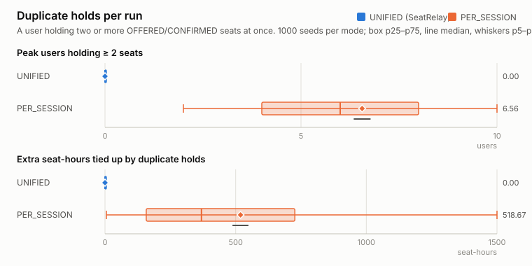
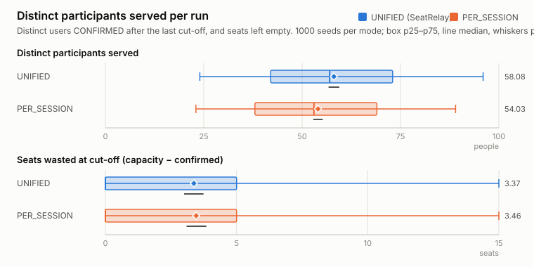
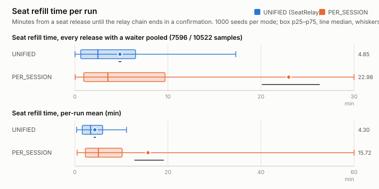

# Mechanism comparison: UNIFIED vs PER_SESSION (replay, simulated clock)

Generated by `pnpm replay` (`tools/replay`) on 2026-10-16T20:16:46.221Z: seeds 1–1000 (1000 scenarios × 2 modes = 2000 runs), 4 worker thread(s), 78.5 s wall clock. Confidence intervals are percentile bootstraps of the mean (2000 resamples, PRNG seed 20261016); the paired difference resamples per-seed differences. Raw rows: `raw.csv`.

## Method

Each seed draws one workshop and one population, then replays the **same arrival and behaviour stream** through the real engine (`@seatrelay/core` `decide()`, its `Change[]` applied to the live snapshot exactly as `applyChanges()` does) twice:

- **UNIFIED** (SeatRelay): one registration per participant carrying the full preference list; one queue per workshop; at most one OFFERED/CONFIRMED hold per person (C2).
- **PER_SESSION** (baseline, plan §2.2): the participant registers separately in every session they find acceptable (as with per-session forms); each session has its own queue and no cross-session constraint. Once confirmed somewhere, the participant cleans up the other registrations only with probability p_cleanup, after a delay; a second offer that arrives while they already hold a seat is accepted (hoarded), declined or ignored according to the drawn secondary reaction.

Expiry is driven exactly like production: every new offer yields a timer, the loop feeds a `TICK` back at `expiresAt` (and at `nextDueAt` / every cut-off, as the sweep would). Timers are ideal, so the engine's relay latency is the pure engine latency.

Scenario ranges (uniform unless stated): sessions 2–5, capacity 5–30 per session, oversubscription 1.2–3× total capacity, holdSeconds 60–900, arrival window 1–72 h (front-loaded arrivals), sessions start 2–120 h after the window (cut-off = start − 30 min), 1–3 acceptable sessions per participant (P = 0.3/0.45/0.25, drawn by session popularity), p_accept 0.55–0.9, p_decline 0.05–0.25 (rest: no response, the hold expires), response delay = holdSeconds × u², p_cancel 0–0.2 (confirmed participants cancel before cut-off), p_abandon 0–0.15 (queued-only participants give up after 0.5–48 h), PER_SESSION p_cleanup 0.2–0.8 (delay ≤ 12 h), p_hoard 0.1–0.4, p_secondary_decline 0.2–0.5.

Metric definitions (all computed from engine outputs, identically for both modes):

- **duplicate holds**: a (user, moment) where the user holds ≥ 2 OFFERED/CONFIRMED seats across sessions; reported as events (user reaches ≥ 2 holds), peak concurrent users and extra seat-hours (∫ Σ_user max(0, holds − 1) dt). UNIFIED forbids this by construction (C2), so 0 is also an invariant check.
- **distinct participants served**: distinct users CONFIRMED after the last cut-off. **duplicate confirmed seats** = confirmed seats − distinct users: seats that an organiser has to chase and release by hand (manual clean-up proxy).
- **seats wasted**: Σ_sessions (capacity − confirmed) read at each session's cut-off.
- **backfill relay latency**: `reallocatedAt − releasedAt` of the engine's BackfillRecords (same-decision relay; with ideal timers it is 0 ms by construction, infrastructure delay is measured on the deployed system instead).
- **seat refill time**: for every released seat (expiry, decline, cancellation), minutes until the relay chain starting at that release ends in a confirmation by a participant who does not already hold a confirmed seat (released → offered → expired/declined → re-offered → … → accepted). An acceptance by someone already confirmed elsewhere (a hoarded duplicate, PER_SESSION only) is followed to the later cancellation of that seat. Releases whose chain never reaches a genuine confirmation (nobody waiting, the run ended, or the duplicate was kept) are counted as censored and excluded from the time statistics.

## Headline results

| metric | UNIFIED mean [95% CI] | UNIFIED median | PER_SESSION mean [95% CI] | PER_SESSION median | Δ PER_SESSION − UNIFIED, paired mean [95% CI] | n |
|---|---|---|---|---|---|---|
| Distinct participants served (people) | 58.08 [56.71, 59.43] | 57.00 | 54.03 [52.84, 55.22] | 53.00 | -4.04 [-4.25, -3.84] | 1000 |
| Fill rate (served / total capacity) (ratio) | 0.950 [0.945, 0.956] | 1.000 | 0.886 [0.880, 0.892] | 0.908 | -0.064 [-0.067, -0.061] | 1000 |
| Seats wasted at cut-off (capacity − confirmed) (seats) | 3.37 [3.00, 3.74] | 0.00 | 3.46 [3.09, 3.85] | 0.00 | 0.09 [-0.01, 0.19] | 1000 |
| Duplicate confirmed seats at the end (manual clean-up steps) (seats) | 0.00 [0.00, 0.00] | 0.00 | 3.87 [3.66, 4.10] | 3.00 | 3.87 [3.67, 4.10] | 1000 |
| Duplicate-hold events (user reaches ≥2 holds) (events) | 0.00 [0.00, 0.00] | 0.00 | 34.57 [33.50, 35.61] | 33.00 | 34.57 [33.56, 35.58] | 1000 |
| Duplicate holds: peak users holding ≥2 seats (users) | 0.00 [0.00, 0.00] | 0.00 | 6.56 [6.34, 6.78] | 6.00 | 6.56 [6.34, 6.78] | 1000 |
| Duplicate holds: extra seat-hours tied up (seat-hours) | 0.00 [0.00, 0.00] | 0.00 | 518.67 [487.70, 548.82] | 369.15 | 518.67 [490.69, 548.06] | 1000 |
| Seat refill time, per-run mean (min) | 4.30 [4.07, 4.55] | 3.39 | 15.72 [12.81, 19.13] | 5.06 | 11.82 [8.68, 15.37] | 847 |
| Seat refill time, per-run p50 (min) | 3.55 [3.34, 3.76] | 2.67 | 5.10 [4.42, 6.18] | 3.49 | 1.57 [0.88, 2.69] | 847 |
| Seat refill time, per-run p95 (min) | 9.45 [8.89, 10.02] | 7.39 | 63.31 [46.22, 82.55] | 11.15 | 55.98 [38.47, 77.31] | 847 |
| Backfill relay latency (reallocatedAt − releasedAt), mean (ms) | 0.00 [0.00, 0.00] | 0.00 | 0.00 [0.00, 0.00] | 0.00 | 0.00 [0.00, 0.00] | 864 |

## Pooled samples

Per-run statistics above weight every seed equally; this table pools the individual samples of all runs instead (so busy scenarios weigh more).

| samples pooled over all runs | mode | n | mean [95% CI] | p50 | p95 | max |
|---|---|---|---|---|---|---|
| Seat refill time, every release with a waiter pooled (min) | UNIFIED | 7596 | 4.85 [4.70, 5.00] | 2.48 | 17.29 | 93.17 |
| Seat refill time, every release with a waiter pooled (min) | PER_SESSION | 10522 | 22.98 [20.09, 26.31] | 3.55 | 35.28 | 4784.15 |
| Backfill relay latency, every relayed backfill pooled (ms) | UNIFIED | 7734 | 0.00 [0.00, 0.00] | 0.00 | 0.00 | 0.00 |
| Backfill relay latency, every relayed backfill pooled (ms) | PER_SESSION | 12174 | 0.00 [0.00, 0.00] | 0.00 | 0.00 | 0.00 |

## All metrics

| metric | UNIFIED mean [95% CI] | UNIFIED median | PER_SESSION mean [95% CI] | PER_SESSION median | Δ PER_SESSION − UNIFIED, paired mean [95% CI] | n |
|---|---|---|---|---|---|---|
| Distinct participants served (people) | 58.08 [56.71, 59.43] | 57.00 | 54.03 [52.84, 55.22] | 53.00 | -4.04 [-4.25, -3.84] | 1000 |
| Fill rate (served / total capacity) (ratio) | 0.950 [0.945, 0.956] | 1.000 | 0.886 [0.880, 0.892] | 0.908 | -0.064 [-0.067, -0.061] | 1000 |
| Seats wasted at cut-off (capacity − confirmed) (seats) | 3.37 [3.00, 3.74] | 0.00 | 3.46 [3.09, 3.85] | 0.00 | 0.09 [-0.01, 0.19] | 1000 |
| Duplicate confirmed seats at the end (manual clean-up steps) (seats) | 0.00 [0.00, 0.00] | 0.00 | 3.87 [3.66, 4.10] | 3.00 | 3.87 [3.67, 4.10] | 1000 |
| Duplicate-hold events (user reaches ≥2 holds) (events) | 0.00 [0.00, 0.00] | 0.00 | 34.57 [33.50, 35.61] | 33.00 | 34.57 [33.56, 35.58] | 1000 |
| Duplicate holds: peak users holding ≥2 seats (users) | 0.00 [0.00, 0.00] | 0.00 | 6.56 [6.34, 6.78] | 6.00 | 6.56 [6.34, 6.78] | 1000 |
| Duplicate holds: extra seat-hours tied up (seat-hours) | 0.00 [0.00, 0.00] | 0.00 | 518.67 [487.70, 548.82] | 369.15 | 518.67 [490.69, 548.06] | 1000 |
| Seat refill time, per-run mean (min) | 4.30 [4.07, 4.55] | 3.39 | 15.72 [12.81, 19.13] | 5.06 | 11.82 [8.68, 15.37] | 847 |
| Seat refill time, per-run p50 (min) | 3.55 [3.34, 3.76] | 2.67 | 5.10 [4.42, 6.18] | 3.49 | 1.57 [0.88, 2.69] | 847 |
| Seat refill time, per-run p95 (min) | 9.45 [8.89, 10.02] | 7.39 | 63.31 [46.22, 82.55] | 11.15 | 55.98 [38.47, 77.31] | 847 |
| Seat releases with a confirmed refill (count) | 7.60 [7.14, 8.04] | 6.00 | 10.52 [9.90, 11.15] | 8.00 | 2.93 [2.56, 3.32] | 1000 |
| Seat releases never refilled (censored) (count) | 24.55 [23.49, 25.60] | 20.00 | 53.95 [52.21, 55.70] | 49.00 | 29.40 [28.31, 30.55] | 1000 |
| Backfill relay latency (reallocatedAt − releasedAt), mean (ms) | 0.00 [0.00, 0.00] | 0.00 | 0.00 [0.00, 0.00] | 0.00 | 0.00 [0.00, 0.00] | 864 |
| Backfill relay latency, p50 (ms) | 0.00 [0.00, 0.00] | 0.00 | 0.00 [0.00, 0.00] | 0.00 | 0.00 [0.00, 0.00] | 864 |
| Backfill relay latency, p95 (ms) | 0.00 [0.00, 0.00] | 0.00 | 0.00 [0.00, 0.00] | 0.00 | 0.00 [0.00, 0.00] | 864 |
| Backfills relayed (someone was waiting) (count) | 7.73 [7.30, 8.20] | 6.00 | 12.17 [11.48, 12.86] | 9.00 | 4.44 [4.04, 4.85] | 1000 |
| Releases with nobody waiting (count) | 24.41 [23.39, 25.46] | 20.00 | 52.30 [50.55, 54.11] | 47.00 | 27.89 [26.83, 28.98] | 1000 |
| Seat releases (expiry, decline, cancel) (count) | 32.15 [30.91, 33.46] | 28.00 | 64.47 [62.34, 66.45] | 59.00 | 32.33 [31.20, 33.49] | 1000 |
| Offers created (count) | 90.22 [88.10, 92.58] | 87.00 | 122.38 [119.24, 125.50] | 117.50 | 32.16 [31.03, 33.34] | 1000 |
| Offers accepted (count) | 64.52 [62.98, 66.05] | 63.00 | 67.87 [66.24, 69.46] | 66.00 | 3.34 [3.11, 3.59] | 1000 |
| Offers declined (count) | 12.98 [12.43, 13.54] | 11.00 | 26.02 [25.14, 26.99] | 24.00 | 13.04 [12.47, 13.62] | 1000 |
| Offers expired (count) | 12.72 [11.93, 13.54] | 9.00 | 27.64 [26.50, 28.76] | 23.00 | 14.91 [14.25, 15.62] | 1000 |
| Offers revoked (cancelled while held) (count) | 0.00 [0.00, 0.00] | 0.00 | 0.86 [0.78, 0.94] | 0.00 | 0.86 [0.79, 0.93] | 1000 |
| Registrations cancelled by participants (count) | 10.57 [10.08, 11.08] | 9.00 | 32.46 [31.13, 33.72] | 27.50 | 21.89 [20.94, 22.89] | 1000 |
| Registrations ended at cut-off (still queued) (count) | 52.27 [50.06, 54.48] | 45.00 | 100.71 [96.40, 105.02] | 84.00 | 48.44 [45.96, 50.88] | 1000 |
| Confirmed seats at the end (seats) | 58.08 [56.67, 59.37] | 57.00 | 57.91 [56.53, 59.31] | 57.00 | -0.17 [-0.27, -0.07] | 1000 |
| Registrations accepted by the engine (count) | 128.65 [125.11, 132.19] | 122.00 | 244.74 [237.11, 252.23] | 232.00 | 116.09 [112.24, 119.68] | 1000 |
| Participants (people) | 128.65 [125.25, 132.28] | 122.00 | 128.65 [125.09, 132.06] | 122.00 | 0.00 [0.00, 0.00] | 1000 |
| Engine decisions (count) | 313.43 [305.37, 321.28] | 302.50 | 457.17 [444.99, 469.07] | 443.00 | 143.75 [139.01, 148.57] | 1000 |
| Rejected commands (count) | 0.00 [0.00, 0.00] | 0.00 | 0.00 [0.00, 0.00] | 0.00 | 0.00 [0.00, 0.00] | 1000 |
| Invariant violations (count) | 0.00 [0.00, 0.00] | 0.00 | 0.00 [0.00, 0.00] | 0.00 | 0.00 [0.00, 0.00] | 1000 |

## Scenario parameters over the 1000 seeds

| parameter | mean | min | max |
|---|---|---|---|
| nSessions | 3.5 | 2.0 | 5.0 |
| totalCapacity | 61.4 | 11.0 | 134.0 |
| nParticipants | 128.7 | 22.0 | 311.0 |
| oversubscription | 2.103 | 1.207 | 2.999 |
| holdSeconds | 483.4 | 60.0 | 900.0 |
| arrivalWindowHours | 38.232 | 1.039 | 71.954 |
| pAccept | 0.724 | 0.550 | 0.900 |
| pDecline | 0.141 | 0.050 | 0.250 |
| pIgnore | 0.135 | 0.020 | 0.393 |
| pCancel | 0.099 | 0.000 | 0.200 |
| pAbandon | 0.072 | 0.000 | 0.150 |
| pCleanup | 0.491 | 0.201 | 0.800 |
| pHoard | 0.249 | 0.100 | 0.400 |
| pSecondaryDecline | 0.350 | 0.201 | 0.499 |

## Totals and sanity checks

| mode | runs | decisions | registrations | offers | expired | declined | accepted | cancellations | invariant violations | run time |
|---|---|---|---|---|---|---|---|---|---|---|
| UNIFIED | 1000 | 313428 | 128651 | 90224 | 12722 | 12980 | 64522 | 10572 | 0 | 108.4 s |
| PER_SESSION | 1000 | 457173 | 244739 | 122381 | 27636 | 26020 | 67866 | 32462 | 0 | 197.4 s |

Invariants (`checkInvariants`) were checked at the end of every run: 0 violation(s). Charts: box = p25–p75, line = median, whiskers = p5–p95, ◆ = mean with its 95% bootstrap CI underneath.
